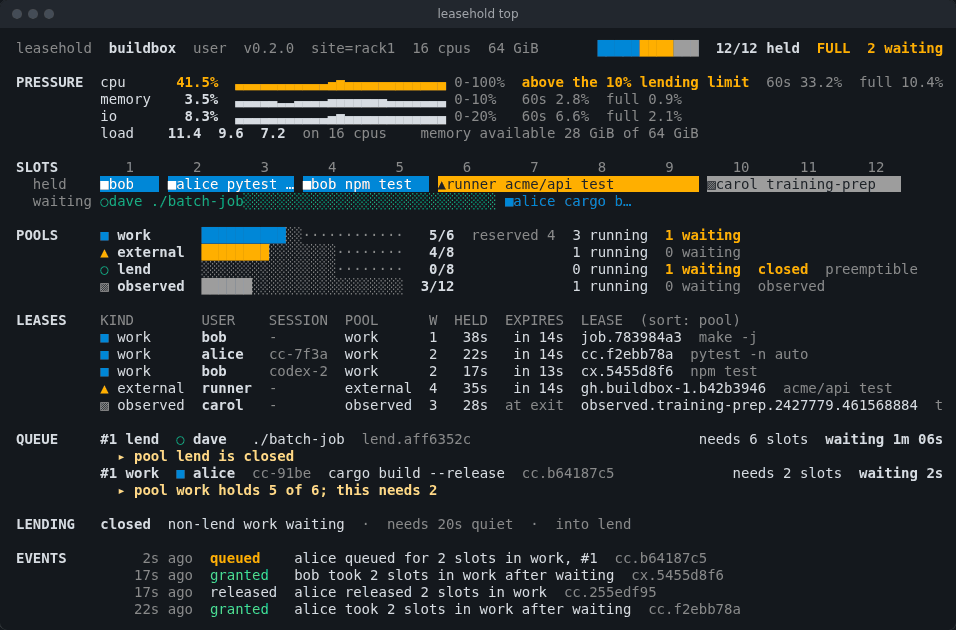

# leasehold

[](https://github.com/chalkworth/leasehold/actions/workflows/ci.yml)


[](LICENSE)

**Run several coding agents on one Linux machine without it grinding to a halt.**

Four agents each decide to run `cargo test` or `pytest -n auto` at the same moment. Each one
sizes itself for the whole machine, so together they ask for four machines' worth of CPU and
memory: memory fills and the machine swaps, your editor and `git status` stutter, and sometimes
the OOM killer takes one of the jobs.

leasehold sits between the agents and the machine. A heavy command takes a **lease** on a share
of the machine before it starts: it waits its turn when the machine is full, runs sized to the
share it was given (`CARGO_BUILD_JOBS`, `PYTEST_XDIST_AUTO_NUM_WORKERS`, a make jobserver), and,
where systemd allows it, runs in a cgroup weighted to that share. When the agent's session ends,
whatever it left running is stopped.



## What it changes, measured

Eight simulated agents start test runs and memory-hungry builds at random on an 8-CPU, 16 GiB
machine ([method and full tables](docs/bench.md)):

| | jobs killed (OOM) | `git status` p95 | 10 ms sleep, p99 late | swap read back | same work took |
|---|---|---|---|---|---|
| unmanaged | 0 of 52 | 981 ms | 25 ms | 2.8 GiB | 566 s |
| `nice -n 19`, a low-weight slice, or a fixed `-j4` | 5 to 9 of 52 | 970 to 1130 ms | 19 to 27 ms | 4.9 to 9.8 GiB | 579 to 630 s |
| leasehold | 0 of 52 | 103 ms | 3.3 ms | 0.2 GiB | 848 s |

The machine stays usable and nothing is lost, at a price: the same work took up to 1.5 times as
long, because heavy jobs wait their turn instead of overlapping. One machine and one run per
condition so far; the memory results vary from run to run.

## Start

```sh
uv tool install leasehold
leasehold setup                 # a config sized for this machine, your own daemon, the PATH shims
leasehold run -- claude         # or codex, gemini, aider, any agent
leasehold top                   # who holds the machine, who waits and why
```

`setup` says what it did at each step, is safe to repeat, and `leasehold setup --remove` undoes
it. It needs no root. Try it without installing anything first: `uvx leasehold demo` runs a
made-up busy machine in `top`.

Inside `leasehold run`, the agent's heavy commands (`pytest`, `cargo`, `make`, `npm test`, `go
test` and the like; `leasehold commands` lists the rules) go through small PATH shims that take
a lease first. Light commands run as they are. A heavy command waits in line, keeping its
place, for up to five minutes; one still waiting then is refused with the reason, which the
agent reads:

```
leasehold: machine busy for 300s: cargo test (session claude_3f9a1c) holds 8 slots, 2 other
leases hold 4; pool work holds 12 of 12; this needs 4; queued #1. The command did not run. Do
lighter work first, then run it again.
```

In Claude Code, the plugin does the same through a hook, without the shims:

```
/plugin marketplace add chalkworth/leasehold
/plugin install leasehold@leasehold
```

## What it promises

leasehold decides **when** a command starts and **how much** of the machine it may use while it
runs. It never decides what runs, and it only touches the processes it started itself.

- **Leases.** A heavy command takes a lease on slots (one slot per CPU, a few kept back for you)
  before it starts and gives it back when it ends. The kept CPUs are kept from commands that
  run the job count they are given; one that ignores it can still fill every CPU unless
  `[contain] hard_cpu = true` caps it (`leasehold doctor` warns while it is off); a holder that crashes gives it back within
  seconds. Turns go round fairly by user, then by agent session, so one busy agent cannot starve
  the others.
- **Sized commands.** The lease's size reaches the command as the job-count variables that
  cargo, make, ninja, CMake, pytest-xdist, Go and others read, and optionally a GNU make
  jobserver shared by the whole build tree.
- **Contained, where systemd allows it.** With a systemd user manager (most desktop and server
  distributions), each command runs in a user scope with `CPUWeight` in proportion to its lease
  and, when a rule says so, a `MemoryHigh`. `leasehold doctor` says whether this machine is
  `enforced (systemd)` or `advisory`, and why. Advisory means the lease and sizing still apply,
  but a command that ignores its job count is not held back.
- **Memory.** A command can declare the memory it will use (`hold --memory`, or its rule's
  `memory`), and declared sizes are counted against a budget: the machine's memory less a share
  kept for you. A command that declares nothing counts a share in proportion to its weight, which
  never holds back more than the slots already do, so the budget only binds declared and
  standing memory. When memory pressure rises, nothing new starts until it eases, and then only
  within the memory measured free. Other programs' memory is not counted: the guard reacts to
  it once it shows as pressure ([measured](docs/bench.md#the-03-defaults)).
- **Clean ends.** `leasehold run` puts the agent's session in a slice of its own and stops what
  it leaves behind (a stray test server, a hung build) when the agent exits.

## How it compares

The first question is a fair one: why not just a systemd slice, or `nice`?

| Tool | What it does | Next to leasehold |
|---|---|---|
| `nice`, a systemd slice with a low `CPUWeight` | Shares the CPU among what is already running | Nothing waits: four builds sized for the whole machine still all start, compete for memory, and each runs at a quarter speed. leasehold uses the same cgroup weights, and adds the waiting and the sizing |
| `flock`, `sem` (util-linux, GNU parallel) | A lock, or a counting semaphore of N slots, around a command | No weights, sessions or load, and nothing to tell the command its size. Enough for one kind of job |
| pueue, task-spooler, nq | A queue that runs your commands later, N at a time | They own and run the job; leasehold only admits it, so the command keeps running in the agent's own shell with its output and exit code |
| agent-semaphore | Coordinates parallel coding agents on one repository: claims on code scopes, conflict warnings, a landing queue | About who edits and merges what, not the machine. The two fit together |
| steve, guildmaster | One GNU make jobserver shared by every build on the machine | Reaches only tools that speak the jobserver protocol. leasehold can size a jobserver from a lease |
| Slurm, HTCondor, Nomad | Cluster schedulers | Built for many machines; out of proportion for one |

## Also works for

The same daemon serves a machine several people or CI runners share: one system daemon under
systemd, `--kind external` leases for self-hosted runner jobs, fair turns across Unix users,
spare capacity lent out and revoked when work arrives, and a webhook, Prometheus metrics and a
browser view. [`docs/reference.md`](docs/reference.md) has the system setup, every config key,
the command line, the HTTP API and the exit codes; [`examples/`](examples/) has a runnable
example of each.

## What it is not

- **Not a scheduler.** It never runs, places or retries your jobs.
- **Not a sandbox.** Containment shares CPU by weight and throttles memory softly; it does not
  stop a command from using an idle machine, and it cannot prevent every out-of-memory kill.
  Without a systemd user manager, it is advisory only.
- **One machine, Linux only.** It reads `/proc/pressure` and uses cgroup v2.

## Stability

leasehold is alpha and before 1.0. The command line, exit codes, config file, HTTP API with its
`status` schema, and the library modules `model`, `admission`, `ledger`, `quota` and `client`
are its interface; a minor release may change them, and [`CHANGELOG.md`](CHANGELOG.md) says
how. The ledger file is not an interface.

## Licence

Apache-2.0. See [`LICENSE`](LICENSE). [`SECURITY.md`](SECURITY.md) says what leasehold trusts and
how to report a problem; [`CONTRIBUTING.md`](CONTRIBUTING.md) how to work on it.
